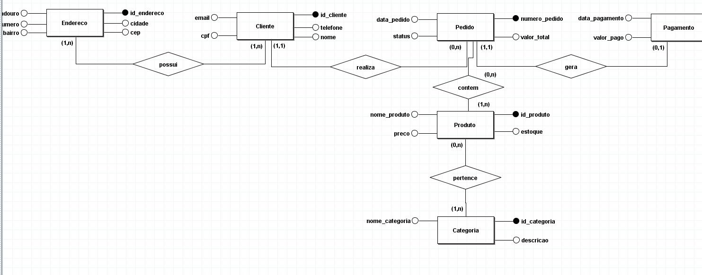
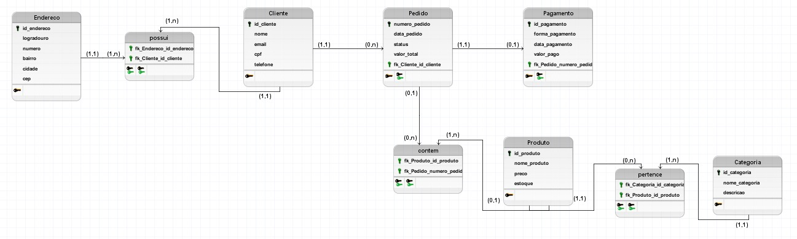

# 🛒 Comércio Digital (`db_comercio_digital`) — Modelagem e Implementação de Banco de Dados Relacional

Projeto de banco de dados relacional em MySQL (`db_comercio_digital`) para e-commerce. Abrange os modelos conceitual, lógico e físico, carga de dados simulados, consultas analíticas e triggers para controle automático de clientes, produtos, estoque, pedidos e pagamentos.

---

## 📋 Índice

- [Sobre o Projeto](#-sobre-o-projeto)
- [Arquitetura e Modelagem](#-arquitetura-e-modelagem)
  - [1. Modelo Conceitual (MER)](#1-modelo-conceitual-mer)
  - [2. Modelo Lógico (Relacional)](#2-modelo-lógico-relacional)
  - [3. Modelo Físico (Dicionário de Dados)](#3-modelo-físico-dicionário-de-dados)
- [Massa de Dados de Teste (DML)](#-massa-de-dados-de-teste-dml)
- [Consultas Analíticas (DQL)](#-consultas-analíticas-dql)
- [Automação e Regras de Negócio (Triggers)](#-automação-e-regras-de-negócio-triggers)
- [Como Executar](#-como-executar)
- [Licença](#-licença)
- [Autores](#-autores)

---

## 🎯 Sobre o Projeto

O **`db_comercio_digital`** foi projetado para sustentar as operações centrais de uma loja virtual de tecnologia e eletrônicos, garantindo integridade referencial, histórico financeiro imutável e prevenção de inconsistências operacionais (como vendas sem estoque ou exclusão de pedidos já faturados).

---

## 🏗️ Arquitetura e Modelagem

### 1. Modelo Conceitual (MER)

Representa a visão de alto nível do negócio em notação Peter Chen, definindo as 6 entidades principais e suas cardinalidades:

  

 

* **`Cliente` ↔ `Endereço` (*possui*):** Um cliente pode ter endereços cadastrados; cada endereço vincula-se ao cadastro de cliente.
* **`Cliente` ↔ `Pedido` (*realiza*):** Relacionamento `1:N` — um cliente realiza nenhum ou vários pedidos `(0,n)`, e cada pedido pertence obrigatoriamente a um único cliente `(1,1)`.
* **`Pedido` ↔ `Produto` (*contém*):** Relacionamento `N:N` — um pedido contém um ou mais produtos `(1,n)`, e um produto pode estar presente em vários pedidos `(0,n)`.
* **`Pedido` ↔ `Pagamento` (*gera*):** Relacionamento `0,1 : 1,1` — um pedido pode aguardar pagamento ou gerar 1 registro financeiro `(0,1)`, e todo pagamento pertence estritamente a um único pedido `(1,1)`.
* **`Produto` ↔ `Categoria` (*pertence*):** Relacionamento `N:1` — uma categoria agrupa nenhum ou vários produtos `(0,n)`, e cada produto pertence a uma categoria `(1,1)`.

---

### 2. Modelo Lógico (Relacional)

Tradução das entidades para tabelas normalizadas, evidenciando as chaves primárias, chaves estrangeiras (`fk_Cliente_id_cliente` em `Pedido` e `fk_Pedido_numero_pedido` em `Pagamento`) e as estruturas associativas (`possui`, `contem` e `pertence`):

  

 

> 💡 *Nota de evolução para o Modelo Físico:* Na implementação final em SQL, os relacionamentos `1:N` entre `Endereço` ↔ `Cliente` e `Categoria` ↔ `Produto` foram simplificados por meio de chaves estrangeiras diretas (`id_endereco` em `tb_cliente` e `id_categoria` em `tb_produto`), enquanto a tabela associativa **`tb_contem`** foi enriquecida com `quantidade` e `preco_unitario` para preservar o histórico financeiro das vendas.

---

### 3. Modelo Físico (Dicionário de Dados)

Implementado em **MySQL/MariaDB** com chaves primárias `INT AUTO_INCREMENT`, restrições `UNIQUE` (para e-mail, CPF, categoria e vínculo `1:1` de pagamento), domínios padronizados via `ENUM` e valores `DEFAULT`:

| Tabela | Descrição | Chave Primária (PK) | Chaves Estrangeiras (FK) | Restrições e Destaques |
| :--- | :--- | :--- | :--- | :--- |
| **`tb_endereco`** | Endereços de entrega | `id_endereco` | — | `uf CHAR(2)`, `numero` e `complemento` aceitam `NULL` |
| **`tb_cliente`** | Cadastro de clientes | `id_cliente` | `id_endereco` (opcional) | `email` e `cpf` com `UNIQUE`; permite pré-cadastro sem CPF/endereço |
| **`tb_pedido`** | Cabeçalho dos pedidos | `numero_pedido` | `id_cliente` | `status` em `ENUM` com `DEFAULT 'Aguardando Pagamento'`; `valor_total DEFAULT 0.00` |
| **`tb_pagamento`** | Transações financeiras | `id_pagamento` | `numero_pedido` (`UNIQUE`) | `forma_pagamento` em `ENUM` (`PIX`, `Cartão de Crédito`, `Cartão de Débito`, `Boleto`) |
| **`tb_categoria`** | Categorias do catálogo | `id_categoria` | — | `nome_categoria` com `UNIQUE` |
| **`tb_produto`** | Catálogo de produtos | `id_produto` | `id_categoria` (opcional) | `estoque INT NOT NULL DEFAULT 0`; permite produtos sem categoria (`NULL`) |
| **`tb_contem`** | Itens de cada pedido (`N:N`) | `id_contem` | `numero_pedido`, `id_produto` | Armazena `quantidade` (`DEFAULT 1`) e `preco_unitario` histórico |

---

## 📦 Massa de Dados de Teste (DML)

O script popula o banco com uma distribuição planejada para cobrir cenários reais e casos de borda (`NULL`, estoque zerado, pedidos cancelados e clientes inativos):

* **8 Categorias:** Incluindo *Realidade Virtual* sem produtos associados (para testes de `LEFT JOIN`).
* **15 Endereços:** Distribuídos em múltiplos estados (`DF`, `SP`, `RJ`, `MG`, `BA`, `PR`, `PE`).
* **20 Clientes:** Contemplando cadastros completos, clientes sem CPF/endereço e clientes sem pedidos.
* **22 Produtos:** Com faixas variadas de preço, 1 item com estoque zerado (`Headset HyperX Cloud III`) e 1 item sem categoria (`Kit Limpeza`).
* **
